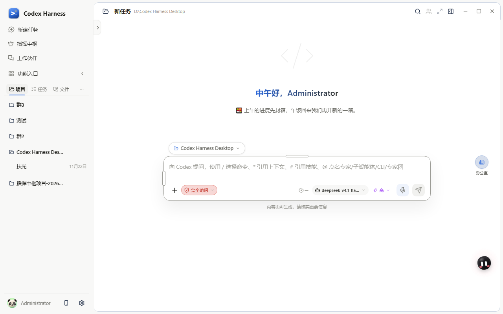

# Codex Harness Desktop

独立桌面工作台，把 OpenAI Codex 引擎装进一个真正的桌面应用：多会话任务管理、可视化 diff 审阅、无限画布与图片编辑、内置自动化工具、插件/技能/连接器生态、专家团队协作，开箱即用，不必碰命令行。

<p align="center">
  
</p>

## 🎯 核心能力速览

| | 能力 | 一句话说明 |
|---|---|---|
| 🗂️ | **多会话并行与排队** | 分组/置顶/归档/分支/批量操作；运行中继续输入自动排队 |
| 🎞️ | **沉浸式对话体验** | 逐字平滑揭示、长会话自动折叠、AI 润色提示词、`@` 引用、图片内联粘贴 |
| 🎨 | **无限画布** | 右键新建卡片、拖大、连线；模型跑画布工作流时右栏自动展开并亮绿灯 |
| 🎙️ | **本机离线语音通话** | 悬浮球一键通话，识别与合成全在本机，零凭据零联网 |
| 🔑 | **OpenAI 官方订阅** | ChatGPT 设备码登录即用，多账号切换，额度实时同步 |
| 🎬 | **本地视频导出** | HTML/CSS 动画一键出 MP4，零 ffmpeg，模型直接调用 |
| 🖼️ | **图片分层引擎** | 分层渲染/合成/调整，会话内修图与生成一体 |
| 🔀 | **多模型与中转站** | 任意 OpenAI 兼容端点自由接入；中转站多账号一键切换 |
| 🧩 | **技能 · 插件 · MCP 生态** | 技能/插件/MCP 三个市场：详情预览 + 一键安装直连引擎 |
| 🖥️ | **桌面与浏览器自动化** | 键鼠/截屏/OCR + 浏览器自动化，随包预装开箱即用 |
| 🧭 | **右侧面板** | 浏览器式标签条：监控/变更/审阅/浏览器/文件/图片/画布/终端；一颗图标可放大覆盖对话区 |
| 📈 | **超长上下文** | 视口外跳过渲染 + 分页懒加载，几个 G 历史也流畅 |
| 🛡️ | **权限分级与沙箱** | 只读/自动编辑/完全访问三档审批，会话中途切换即时生效 |

**还有**：专家团并行调度 · 中枢会话可展开成员子会话 · 审批卡一行不占屏 · 会话切换缓存直渲 · 大 diff 行级虚拟化 · 三层记忆自动沉淀 · 微信/Telegram/飞书/钉钉/QQ Bot 远程接入 · xterm 内置终端 · 会话备份导出 · 应用内自更新 · 浅色/深色主题。

## 🖼️ 界面预览


无人打扰的空会话状态：左侧「新建任务 / 指挥中枢 / 工作伙伴」与项目、任务、文件三个视图；中间对话与输入框（模型、权限、语音都在触手可及处）；右侧标签条按需开页，点标签条左侧那颗图标即可把右栏放大覆盖整个对话区。

## ✨ 功能特性

### 🚀 任务与会话管理
- **多任务并行**：侧栏按分组/项目管理会话，置顶、归档、重命名、分支、批量操作
- **消息排队**：运行中继续输入自动排队依次发送，≥2 条可折叠、可拖动调整顺序
- **会话绝对独立**：切会话、开弹窗、改配置都不会打断正在跑的任务
- **会话级模型/思考档位/权限**：每个会话各记各的，多窗口并发不丢配置；换模型下一条消息立即生效
- **统一内置通道**：切换供应商零迁移，旧会话自动接力，历史完整保留
- **超长上下文**：分页懒加载（打开只渲染最近 5 回合，往上滚自动续载），≥70% 一键压缩、≥80%/≥95% 预警
- **计划可编辑**：Codex 的执行计划可勾选、改文字、增删，改完发回执行
- **评审子智能体**：用干净上下文复审 Codex 的成果，报错前自审去误报
- **文档附件**：PDF/Word/Excel/PPT 拖进对话转成 Markdown 正文（markitdown，本机转换不上传）
- **输入体验**：草稿按会话独立保存；文件/图片内联 chip；粘贴超 200 字自动转 .txt；`#` 引用技能
- **内置写作技能**：humanizer / no-ai-slop / i-have-adhd（MIT，可单独停用）
- **会话备份与导出**：Markdown 导出、跨设备恢复

### 🎨 画布与创作
- **无限画布（右栏）**：右键新建便签/生图/图片/脚本/角色/场景/分镜/镜头/音频/视频十类卡片；卡片可拖大、可连线、可复制粘贴剪切
- **与模型协作**：模型读写画布工作流时右栏自动展开并亮绿灯，卡片随回填同步更新
- **图片入画布**：消息、附件、文件树的图片右键「在画布中打开」，直接落成图片卡
- **图像工坊**：会话内修图（jimp 纯本地）、生成、图层查看；**生成与编辑分属独立通道**
- **图片分层引擎**：分层渲染 / 合成 / 局部调整（亮度、色相、模糊、遮罩等）
- **HTML → MP4**：网页动画一键导出视频（零 ffmpeg，本地渲染）

### 🖥 界面与右侧面板
- **浏览器式标签条**：监控 / 变更 / 审阅 / 浏览器 / 文件 / 图片 / 画布 / 终端，每个标签可单独关闭，默认停在新标签页入口
- **放大覆盖**：标签条左侧一颗图标两段 —— 左半把右栏放大覆盖整个对话区，右半缩回原宽
- **组件库**：设置 →「组件库」，Uiverse 现成组件按类目浏览、点开看代码一键复制；Codex 写前端自动查库
- **桌面宠物 / 像素办公室**：官方 pet.json 格式浮窗宠物（内置六只）；专家团成员实时映射成虚拟办公室工位
- **内置浏览器**：右侧面板多标签浏览，隐身浏览走指纹内核（过反爬）
- **流式平滑渲染**：正文/思考逐字揭示；工具调用、深度思考自动折叠成卡片
- **会话切换秒开**：缓存直渲 + 阅读位置还原（实测 P50 20ms）
- **提示词增强**：输入框一键 AI 润色，悬停预览、一键还原
- **图片体验**：点击放大灯箱（滚轮缩放）、悬停小预览、复制图片、打开所在位置
- **项目树**：多标签预览、行号常开、语法高亮、直接编辑保存、HTML 一键浏览器打开

### 📱 移动端远程控制
- **手机扫码即控**：扫码后在手机上查看会话、收发消息（自有固定公网地址优先，回退局域网）
- **两道安全关**：6 位配对码 + 电脑端审批；已批准设备免重复配对，可随时移除
- **机器人同样要配对**：微信/QQ/飞书/钉钉/Telegram 首次对话先发授权码

### 🎙️ 本机离线语音通话
- **一键通话**：悬浮球点击即通话，实时字幕、开口即打断；应用内来电式通话界面
- **全本机推理**：识别与合成本机跑（sherpa-onnx），零凭据零联网，模型按需下载（约 270MB）
- **语音唤醒**：内置 KWS 关键词模型，说唤醒词即唤起
- **音色**：内置精选音色可试听；支持导入/录制音频克隆专属音色（ZipVoice 按需下载）
- **听写**：输入框麦克风按钮，说话实时进输入框；引擎能区分语音消息与打字消息

### 🔌 能力生态
- **OpenAI 官方订阅**：设备码登录免 API Key，多账号批量管理，额度实时同步
- **中转站中心**：sub2api 兼容，多账号一键切换，余额/套餐实时透出
- **技能中心**：SkillHub 市场按需检索安装，英文描述统一中文化
- **插件市场**：Gitee 官方镜像（Claude Code 官方市场中国版），名称简介全中文，一键安装
- **专家市场 / 人格市场**：专家包与人格一键应用
- **连接器（MCP）**：飞书/钉钉/腾讯文档等可视化配置 + MCP 市场
- **专家团队**：多角色专家团按 SOP 编排，并行阶段整组同时干活，头像轨看进度
- **指挥中枢**：中枢会话可展开派出去的成员会话，成员消息带上级身份显示，右侧有运行反馈
- **会话级调度**：Codex 可把子任务委派给专家/子智能体，四层防护防套娃

### 🛠 自动化工具箱
- **桌面自动化**：截屏/键鼠/窗口控制/OCR（Nuphus + agent-desktop 随包预装），视觉识图已接通
- **浏览器自动化**：Ego Lite 外部应用为默认通道，反检测指纹内核按需下载
- **RPA 流程自动化**：跑通的流程一键存为配方随时复现
- **随包内置运行时**：Node / VS Code CLI / Python（完整版，自带 pip + Tkinter）/ ripgrep / uv / CMake / 7-Zip / jq / Ninja / yt-dlp / adb / cloudflared / ponytail
- **按需下载（>50MB 的大件）**：PowerShell 7 / Git / FFmpeg / Miniconda / MinGW 与浏览器内核，「开发工具」页一键装，国内镜像优先
- **终端**：xterm 内置终端，会话级持久化

### ⚙️ 工程化细节
- **权限分级**：只读/自动编辑/完全访问三档，敏感操作确认执行
- **MCP 逐工具权限**：允许/需批准/拒绝三档，拒绝=真阻断（写进引擎 disabled_tools）
- **多模型接入**：任意 OpenAI 兼容端点；协议自动适配（Responses ↔ Chat Completions），Chat 网关直接用
- **思考等级**：低/中/高/最高/极高五档跟模型保存；**自动档**由本地 Laya 模型 33ms 判定，手选立即覆盖
- **供应商管理**：启用/停用状态药丸、连接自检带排查清单、模型参数内置规格表自动填
- **应用内自更新**：GitHub Releases 单源，完整包，点胶囊才下载与安装（启动不自动检查）
- **大文件下载更稳**：多镜像轮换 + 断点续传 + 卡死判定
- **隐私与安全**：密钥 safeStorage 加密落盘、本地服务只绑 127.0.0.1、无遥测

## 📦 下载安装

前往 [Releases](../../releases) 页面下载：

| 平台 | 文件 |
|---|---|
| Windows 10/11 x64 | `Codex.Harness.Desktop-<版本>-win-x64.exe` |
| macOS Apple Silicon (M1-M4) | `Codex.Harness.Desktop-<版本>-arm64-mac.zip` |
| macOS Intel | `Codex.Harness.Desktop-<版本>-x64-mac.zip` |

> 选哪个包：苹果菜单 →「关于本机」→ 芯片写 **Apple M1/M2/M3/M4** 选 arm64，写 **Intel** 选 x64。建议留 **10 GB** 磁盘空间（解压与首次启动还要下载运行时）。

**macOS 首次打开**（安装包未签名，Gatekeeper 会拦）：

1. **在「下载」里解压**（别在「应用程序」里解压，会报错误 640）；报 640 就用终端：`cd ~/Downloads && ditto -x -k "<zip 文件名>" .`
2. 把 App **拖进「应用程序」**（别在「下载」里直接双击运行）
3. **右键 → 打开**（不要直接双击）
4. 仍提示「已损坏」时，终端执行下面这条命令 —— **把应用图标拖进终端**，路径会自动补全（不用手打）：

```bash
xattr -dr com.apple.quarantine "/Applications/Codex Harness Desktop.app"
```

> 基础运行时不再整体内置：小体积工具随包，大件（>50MB）在「开发工具」页按需下载（国内镜像优先、失败回落官方源）。缺必需工具时首启自动弹「环境体检」一键补齐。

## 🛠 从源码构建

```bash
git clone https://github.com/PMZPZM0/codex-harness-desktop.git
cd codex-harness-desktop
npm install
npm run dev        # 开发模式
npm run dist       # Windows 安装包（NSIS）
```

⚠️ `resources/tools/*` 不在 git 里（大体积二进制），干净检出构建前由 `scripts/prepare-windows-tools.cjs` / `prepare-mac-tools.cjs` 现造；打包后用 `node scripts/verify-packaged-tools.cjs <产物 tools 目录>` 验收。

## 🚀 发版（推 tag 即发布）

发布渠道只有 GitHub Releases，构建与发布全部在 CI（`.github/workflows/release.yml`）：

```bash
# ① 版本对齐 4 处：package.json / package-lock.json（根 + packages[""]）
#    / electron/whats-new-notes.ts 最新条目 / docs/releases/v<版本>.md
npm run check                          # ② 离线预检全绿
git push origin HEAD:refs/heads/main   # ③ 推代码
git push origin v<版本>                # ④ 推 tag → 触发 Windows + macOS 构建并发布
```

发版前必做两件事：**mac 适配审计**（`node scripts/mac-audit.mjs <上一版 tag>`，逐条判读新增行的平台敏感模式，结论写进发版说明的 macOS 段）；**组件版本体检**（引擎、随包工具、依赖，只升同大版本，跨大版本单独一轮）。资产命名是更新器契约（mac 包必须含 `mac`+`.zip`+架构名），名字错了用户端静默显示「已是最新」。

## 🧪 验证与测试

本项目硬性要求：**任何源码改动必须以自动验收全绿为完成标准**。

```bash
npm run verify   # = npm run check（离线预检）+ npm run accept（拉起应用跑验收项）
```

- `npm run check`：构建 + IPC 桥一致性 + 纯函数行为断言，毫秒级不需要图形界面
- `npm run accept`：驱动真实应用跑验收，默认只跑最新一轮，失败自动截图（`.e2e-artifacts/shots/`）
- 改了哪个模块就给 `scripts/guards/` 对应域文件加可保留的检查项；真链路证据每轮现写、跑完即删
- 看全新用户首启：`npm run preview:fresh`（前台运行，不碰真实配置）

详见 [`docs/TESTING.md`](docs/TESTING.md)。

## 🏗 技术栈

- **Electron 44** + **React 19** + **Vite 8** + **TypeScript 6**
- 画布：`@xyflow/react` 12
- 引擎通信：stdio JSON-RPC 对接 `@openai/codex` app-server
- 终端：`@lydell/node-pty` + `@xterm/xterm`

## 💾 数据与更新

所有用户数据存放在 `%APPDATA%\Codex Harness Desktop\`（macOS 为 `~/Library/Application Support/`），更新应用或引擎都不会丢失。

## 📋 系统要求

- Windows 10 1809+ / macOS 12+（Intel 或 Apple Silicon）
- 至少 10 GB 可用磁盘空间，建议 8 GB 及以上内存
- 需要能访问所配置的模型 API 端点

## 💬 反馈与交流

| 渠道 | 地址 |
|---|---|
| 🐛 GitHub Issues | [提交 Bug / 建议](../../issues) |
| 💬 官网反馈页 | [dl.ppz123.asia/feedback.html](https://dl.ppz123.asia/feedback.html) |
| 📦 下载与更新 | [GitHub Releases](../../releases)（唯一更新源） |

## ⚠️ 免责声明

本项目是对 OpenAI Codex CLI 的独立桌面封装，与 OpenAI 官方无隶属关系。使用本项目产生的 API 调用费用由用户自行承担。请遵守所在地区法律法规及 OpenAI 使用条款。

## 💝 赞助支持

<p align="center">
  <a href="https://api.pptoken.cc/register?aff=X82JSNVC3W3S" style="display:inline-block;padding:12px 32px;background:linear-gradient(135deg,#8b5cf6,#6366f1);color:#fff;border-radius:10px;font-size:15px;font-weight:600;text-decoration:none">💝 立即注册支持我们 →</a>
</p>

## License

[MIT](LICENSE)
